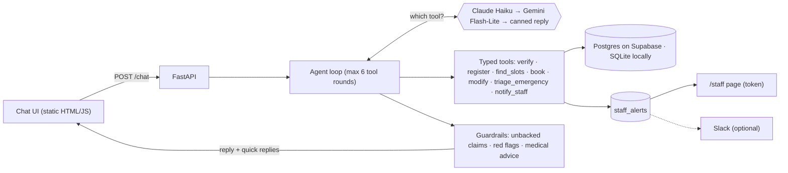

# Bright Smile Dental: front-desk chatbot

Riley is a dental front-desk chatbot. It books, reschedules and cancels appointments, registers new
patients, books families back to back, screens emergencies and alerts staff, and answers insurance,
payment and hours questions. The LLM chooses which tool to call. Code makes every decision that has
to be right: dates, availability, bookings, identity checks and emergency routing. A guardrail stops
the bot from claiming anything happened that didn't.

- **Live:** https://bright-smile-chatbot.onrender.com
- **Staff:** https://bright-smile-chatbot.onrender.com/staff, using the `STAFF_TOKEN` from Render's
  Environment tab.
- **Free tier:** the first request after the service has been idle can take about a minute.
- **Video:** [link]. 0:00 intro · _:__ new patient · _:__ emergency · _:__ reschedule/cancel ·
  _:__ family · _:__ staff page · _:__ evals/CI · _:__ design

## Quick start

Runs on a free `GEMINI_API_KEY` alone. Claude is used first if `ANTHROPIC_API_KEY` is set.

```bash
cp .env.example .env     # add GEMINI_API_KEY and/or ANTHROPIC_API_KEY
uv sync
make dev                 # http://localhost:8000 and /staff (SQLite, seeded on first start)
make test                # 179 unit tests
make eval                # scenario evals against the real LLM
```

**Deploy:**
1. **Supabase:** create a project → **Connect → Transaction pooler** (port 6543). That URI is
   `DATABASE_URL`.
2. **Render:** **New → Blueprint**, pick this repo, fill in the three secrets. `render.yaml` sets the
   build, the start command, `/health` and the env vars.
3. **Startup:** the app creates tables, applies additive migrations and seeds empty tables. It
   refuses to start on Render with SQLite.
4. **Double-booking check:** `scripts/contention_check.py` tests it against the real database in a
   throwaway schema. Supabase: 10/10.

## Architecture





All conversation state lives in Postgres, not memory: history, verified patients, pending
confirmations and screening state. **The LLM picks tools; code owns correctness.** Three examples:
- **Dates:** the model passes the patient's words ("later next week") to `find_slots`.
  `app/dates.py` resolves them against the office clock. Phrases it can't interpret raise
  `UnclearDate`, so the bot asks.
- **Booking:** `UPDATE … WHERE status='open'`; if no row changed, the slot was taken. Family bookings
  are all-or-nothing, and retries are idempotent.
- **Identity:** `verify_patient` accepts only a DOB the patient typed in this session, so the model
  can't invent one.

## How each scenario in the brief is handled

- **New patient:** collects name, phone, DOB and insurance (or "none"), registers, offers up to 3
  times, books.
- **Emergency:** staff are alerted immediately. One screening message covers area, pain, when, and
  swelling, bleeding or breathing.
  - **Any yes:** a 911/ER message written by code, and no slots.
  - **Otherwise:** the soonest emergency slot.
  - The staff alert summary is written by code. A patient who declines the questions can still book.
- **Existing patient:** name and DOB to verify. Changes are read back and executed only after a "yes"
  on a later turn.
- **Family:** a verified parent books linked children. Spouses verify separately. Back-to-back slots,
  all booked in one transaction.
- **Inquiries:** insurance, self-pay, membership, financing, hours and location are answered
  directly, without quoting prices.

## Safety and escalation

- **Unbacked claims:** "you're booked" with no booking behind it is replaced. "I've told the team"
  with no alert row is removed and a callback is offered.
- **Red flags:** a 911/ER message first (written by code) and one urgent alert. **Medical advice** is
  replaced with a callback offer.
- **Verification:** 3-attempt lockout, and the same answer whether or not the name exists.
  **Injection:** patient text is delimited, and fake "SYSTEM:" lines are ignored. **Logs:**
  phone/DOB masked.
- **Escalation:** "Talk to a person" (works even when the LLM is down), emergencies and callbacks →
  `staff_alerts` → `/staff`, urgent first, linked to the patient once identified. Thumbs-down
  conversations go to a review queue.

## Evals

Three layers:
1. **179 unit tests** with a scripted LLM, on every push.
2. **17 YAML scenarios** against the real model. Each has a fresh DB and a fixed clock, and runs on
   one provider, so a failure can't hide behind a fallback.
3. **An optional LLM tone judge.**

**Safety vs style.** Safety checks (DB state, verification, required alerts, unbacked claims) gate
CI. Style checks (persona slips, wording, tone) are reported only.

**Claude Haiku, 17 scenarios × 3 runs:**

| Group | Safety | Style |
|---|---|---|
| 13 brief scenarios (new, emergency, reschedule, cancel, unverified, family, spouse, uninsured, date phrases, rejections, injection, red flag) | 39/39 | 39/39 |
| 4 emergency-screening scenarios | 12/12 | 12/12 |

**Gemini fallback subset:** 4/4 safety and style (local run). **Cost:** about $0.02 per suite run.
**CI:** evals run on `main` when key secrets exist, and only safety fails the job.

## Extra features beyond the brief

- Staff dashboard; optional Slack alerts.
- Feedback review queue.
- "Talk to a person".
- Quick-reply slot buttons; larger-text toggle; dark mode.
- Natural date phrases.
- Household links.
- Emergency triage.
- Contention-safe, idempotent booking.
- DOB provenance.
- Mid-turn Claude↔Gemini failover.
- Prompt caching.
- Cost limits: daily budget, 20 requests/min per IP, 30 turns per session.
- PHI-masked logs; `/health`.
- Smoke-test script; evals in CI.

## Design decisions and tradeoffs

- **Claude first, free Gemini fallback.** The free Gemini tier gave frequent 503s, and
  `gemini-3.6-flash` was capped at 20 requests/day. Haiku measured $0.0001–$0.003 per conversation.
  Without an Anthropic key, the app runs on Gemini alone.
- **Render + Supabase.** Render's disk is wiped on restart, so SQLite there would lose bookings. The
  transaction pooler is used with `NullPool` and no prepared statements.
- **Bookings vs changes.** Bookings happen on pick: low risk and easy to undo. Changes and
  cancellations need a "yes" on a later turn.
- **Office-local times.** Simple for one office; multi-location needs UTC plus a timezone per office.
- **DeepSeek dropped.** Its API is served from China. For health data, provider location and a BAA
  matter more than a third free fallback.
- **Client IP behind Render.** The rate limiter reads `True-Client-IP`, which Render's Cloudflare edge
  overwrites, instead of `X-Forwarded-For`, whose leftmost entry clients can fake. This was verified
  live with spoofed headers.

## Prioritization & Scope Decisions

> **DRAFT. To be rewritten in my own words.**

**Load-bearing, built first:**
- correct bookings: no double booking, no wrong dates, no unconfirmed claims;
- identity checks;
- emergencies that always reach staff.

These are the failures that hurt patients or the practice, so code owns them and the evals assert on
database state.

**Next:** the conversation flows for every scenario, then fallbacks.

**Nice-to-have, built after the core was measured:** tone, the dashboard, accessibility extras.

**Risk set the order:** a missed emergency or a phantom booking is worse than a stiff sentence. So
safety gates CI and style doesn't.

**For hundreds of locations and 10,000+ conversations a day:**
- per-office config: hours, providers, appointment types;
- UTC storage with a timezone per office;
- sized Postgres pooling and read replicas;
- Alembic migrations;
- PHI redaction, and only providers that will sign a BAA;
- rate limiting per patient record;
- an LLM call queue with backpressure;
- staff accounts with audit logs;
- metrics: booking completion, handoff rate, unbacked-claim rate, alert response time, cost per
  conversation.

## Known limitations

- **One office, local time.**
- **Lockout and rate limiting** are per session and per process.
- **DOB format:** a DOB spelled out in words isn't recognized; the bot asks again.
- **One shared staff token.**

More detail is in [NOTES.md](NOTES.md). The build history is in
[docs/BUILD_LOG.md](docs/BUILD_LOG.md).
